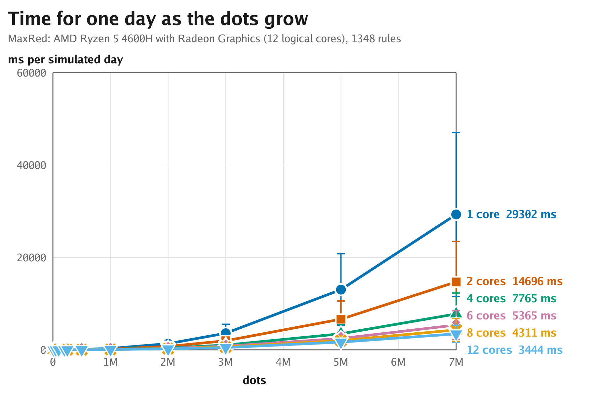
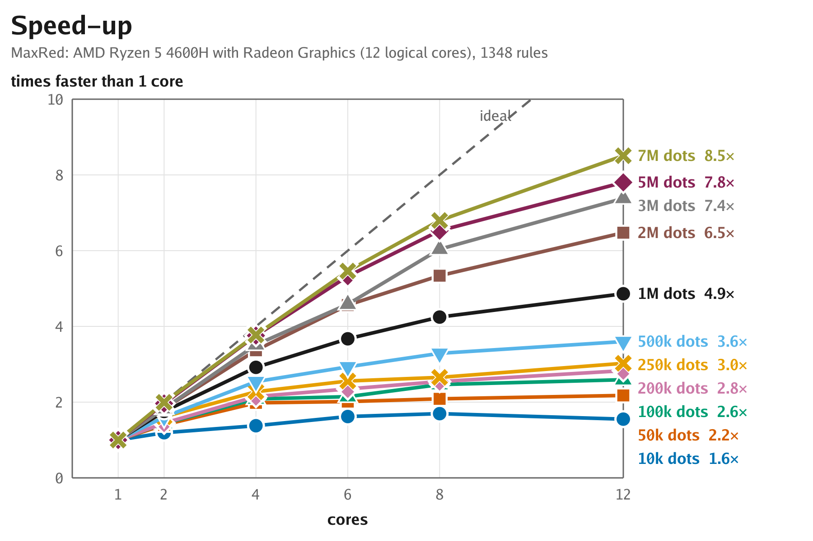
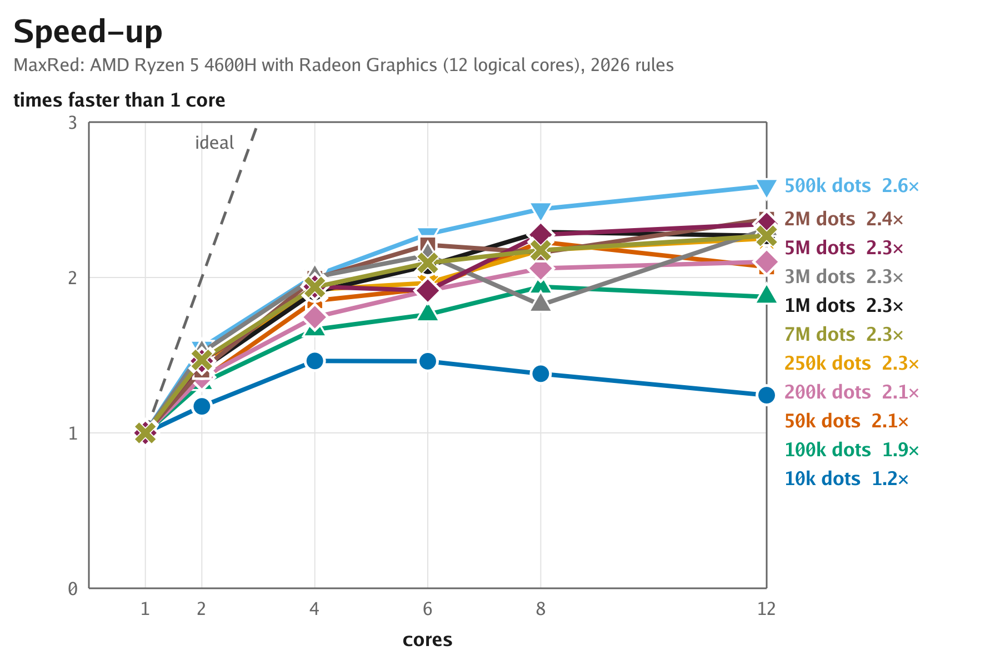

# Black Death simulation — Ireland

What if the Black Death broke out in Ireland? Compare **1348** conditions (the year it really arrived, with no medicine) with **2026** conditions (antibiotics, cars, and a public-health response modelled on Ireland's handling of COVID-19). Both use the real 2025 population of the whole island.

```bash
go run ./src
```

The whole island fits in the window, and each dot is **about 35 people**.

## Controls

| Key | What it does |
|---|---|
| **Arrow keys** or drag | move around the map |
| **+ / −** or mouse wheel | zoom in and out (up to about 60 km across, enough to see single dots in Dublin) |
| **0** | show the whole island again |
| **Y** | switch between **2026** and **1348** rules (same seed, so you can compare the two eras on the same outbreak) |
| **B** | switch background: satellite, beige map, population (with a key) |
| **V** | switch view: dots, % infected now, % dead |
| **[** and **]** | slow down / speed up |
| **Click** a county | seal it or open it |
| **Space** | pause |
| **R** | start a new outbreak (with a new seed) |

The days stop when nobody is infected or incubating and no plague is left in the rats; the status line then says OUTBREAK OVER, and **R** starts a new outbreak. (Rats can restart an outbreak after the last human case, so it doesn't stop at the first day with no sick people.)

Each outbreak starts at a random place, more likely where more people live. A yellow ring marks it, and the status line names the nearest town and shows the outbreak's **seed**. Run `go run ./src -seed 123456` to see that exact outbreak again.

| Colour | Meaning |
|---|---|
| green | healthy |
| orange / yellow | caught bubonic / pneumonic plague, not ill yet |
| red | ill with bubonic plague |
| purple | ill with pneumonic plague (spreads through the air) |
| blue | recovered and immune |
| brown shading | plague among the rats and fleas |
| thin lines and names | the 32 counties |
| red tint, name on a red label | a sealed county (see below) |

The dead are not drawn, but they are counted. The numbers at the top of the window and under the map are in real people (dots × about 35), so they move in steps of about 35.

### County lockdowns

Counties close their borders with the same rule as the towns in our Team-Dolphin-Dog simulation:

- **A county seals** when 0.5% of the people in it are ill (bubonic or pneumonic). It **reopens** when that falls below 0.25%. The setting is `lockdownAt` in `response.go`.
- **Click a county** to seal or open it yourself. After that the rule leaves it alone until the next outbreak.
- **While a county is sealed**, nobody crosses its border: daily movement and trips that would cross it don't happen. On the day it closes, everyone is put on the right side first. Travellers and people visiting go home, and so do diagnosed people isolating at home. Ambulances taking patients to hospital can still cross.
- **Rats and fleas still cross county borders.** A border closure doesn't stop them.
- **1348** doesn't seal counties by itself, but you can still click them.

The 0.5% is lower than the 5% the towns use, because in 2026 no county ever gets near 5% ill at once (1–2% at most). The status line shows how many counties are sealed, and the CSV has a `counties_sealed` column.

### Isolation and quarantine

In 2026, the quarantine works like the one in our Team-Dolphin-Dog simulation, with numbers for Ireland:

- **Every county has an isolation hospital**, drawn as a white square with a red cross where the most people in the county live. It turns pale red when it is full. Zoom in to see beds used / beds.
- **Beds come from real bed numbers.** The Republic has about 2.1 public acute beds per 1,000 people and Northern Ireland about 3.0. A fifth of them are freed for plague by cancelling planned care, as hospitals did in March 2020. That's about 3,300 beds for the whole island.
- **A diagnosed person goes to their county's hospital.** If it is full, an ambulance takes them to the nearest hospital with a free bed, even across a sealed border. Patients can't infect anyone. When the illness ends, survivors go home.
- **When every bed on the island is taken, diagnosed people isolate at home** with antibiotics. They stay put but still infect a quarter as many people as before, because they share a home. Pneumonic plague needs hospital care, so at home it kills 1.5 times as often (46% instead of 31%).
- **Close contacts are quarantined for 7 days.** For each diagnosed pneumonic case, tracers look for up to 5 close contacts (one dot is about 35 people, so that's about 5 contacts each), starting with the people the case infected. Those reached in time get 7 days of preventive antibiotics, which stops the illness if they caught it, and stay at home for 7 days. A doctor checks them every day, so if they fall ill anyway they are diagnosed that day.

Plague guidance only asks contacts who refuse antibiotics to stay at home. Quarantining every traced contact is the stricter COVID-19-style rule, and an assumption here.

The third status line shows how many people are in hospital, isolating at home and in quarantine, and the CSV has `in_hospital`, `isolating_at_home` and `quarantined` columns (in dots).

### Graphs

Four graphs beside the map follow the outbreak day by day:

- **Everyone**: how many people are in each state, on a scale of the whole island. This is the clearest graph for 1348.
- **Caught it or ill now**: only the four sick states, scaled to the highest so far, so a small 2026 outbreak still shows. The black line is people in hospital, as in Team-Dolphin-Dog.
- **Deaths per day (7-day average)**: averaged over a week, because the counts move in steps of about 35 people.
- **Counties sealed**: out of 32 (2026 only).

The faint upright lines mark the days the response reached each stage: first case confirmed, public health emergency and stay-at-home order.

### Area view

Press **V** to colour the island in 10 km squares instead of dots:

- **% infected now**: the share of each square's people who have caught plague or are ill. This shows where the outbreak is burning right now.
- **% dead**: the share who have died so far, counted where they died. This shows where it has been.

Colours run from pale yellow (0.5%) through orange (2%) and red (10%) to dark red (50% or more), with a key beside the map. Squares with fewer than 5 dots are left blank.

## Settings

Everything is switched on and off at the top of `main.go`:

| Setting | What it does when on |
|---|---|
| `isolateDiagnosed` | diagnosed people go to an isolation hospital, or isolate at home when the beds run out |
| `quarantineContacts` | traced close contacts stay at home for 7 days with a daily check |
| `contactTracing` | close contacts of pneumonic cases are traced and get preventive antibiotics |
| `socialDistancing` | people mix less once emergencies are declared |
| `travelCuts` | trips drop once emergencies are declared |
| `countyLockdowns` | counties close their borders when 0.5% of their people are ill |
| `mapBackground` | beige map available with **B** |
| `populationBackground` | population map available with **B** |
| `saveCSV` | daily counts saved to `plague.csv` when the window closes |
| `batchMode` | `go run ./src -batch 5` runs 5 outbreaks of each era without a window |
| `randomStart` | random starting place (off = always Dublin) |

The six measures only affect 2026.

## The 2026 response

One response covers the whole island, although Northern Ireland has its own health service. The numbers come from how Ireland handled COVID-19 in 2020:

| Setting | Value | Basis |
|---|---|---|
| Public health emergency | 12 days after the first confirmed case | 2020: first case 29 Feb, schools closed 12 Mar |
| Stay-at-home order | 27 days after | 2020: stay-at-home order 27 Mar. Northern Ireland was similar (schools closed 18 Mar, UK lockdown 23 Mar). |
| Put off seeing a doctor by cost | 19% | 25% in the Republic delay GP visits because of cost (about 58% pay €50–80 a visit). GP care is free in Northern Ireland. Weighted by population. |
| Mixing less | 35% at the emergency stage, then 75% | Contacts fell 74% under the 2020 UK lockdown; Ireland's COVID-19 reproduction number fell to 0.7–1.0 by mid-April 2020 |
| Trips still happening | 65%, then 30% | Car traffic fell about 35% after schools closed and about 70% under the stay-at-home order |
| Contacts reached in time | 30% → 40% → 50% (assumption) | The HSE reached 94% of COVID-19 contacts, usually within a day, but only those treated before falling ill count |
| Diagnosis chance | 2% a day at first, rising to 30% (assumption) | Plague is notifiable at once in Ireland, but Irish doctors have not seen it in modern times |
| County lockdowns | sealed while 0.5% or more of a county is ill, reopened below 0.25% | the Team-Dolphin-Dog town rule |
| Plague beds | about 3,300 (a fifth of 16,800 acute beds) | about 11,000 public acute beds in the Republic (3.9 million bed days in 2023, ESRI) and 5,835 in Northern Ireland (NISRA, 2024/25); the fifth is an assumption |
| Isolation | in hospital until the illness ends; at home when beds run out | pneumonic patients need airborne precautions for at least 48 hours of antibiotics (NSW plague guideline) |
| At home | infects a quarter as many; pneumonic deaths × 1.5 (assumptions) | |
| Close contacts | up to 5 per pneumonic case, 7 days of antibiotics and quarantine | 7 days of preventive antibiotics and daily checks (NSW plague guideline) |
| Pest control | within 30 km of each case, after 10 days (assumption) | Rats are the owner's or council's job; the HSE treats homes only in Dublin |
| Death rate when treated | 13% bubonic, 31% pneumonic | Clinical review of treated cases (same as the USA version) |

## Results

From `go run ./src -batch`:

| Rules | Average deaths | Range |
|---|---|---|
| **2026** | **≈ 34,000** (0.5%) | single runs vary a lot (36 runs; standard deviation about 17,000) |
| **1348** | **≈ 4.4 million** (62%) | 4.40 – 4.43 million (5 runs) |

The 2026 row was measured before the current county rule and the isolation hospitals. With both, 24 runs of 2026 averaged about 37,000 deaths (10,500 to 73,000). The plague beds filled up in 15 of the 24 runs, and up to about 2,300 contacts were in quarantine at once.

These are not predictions. Pneumonic plague infects only about 1.3 people per case, so small changes push it either side of growing or dying out.

### What each measure is worth

2026 rules, with one measure switched off at a time. These rows were measured with eight runs each, before county lockdowns were added:

| Switched off | Average deaths |
|---|---|
| nothing (all on) | ≈ 40,000 |
| `isolateDiagnosed` | ≈ 35,000 |
| `contactTracing` | ≈ 35,000 |
| `travelCuts` | ≈ 36,000 |
| `socialDistancing` | **≈ 5.1 million** |

Single runs range from about 15,000 to 77,000, depending mostly on where the outbreak starts. So the first four rows are all the same within that noise.

**County lockdowns**, measured with the earlier rule (seal for 14 days after a county's last diagnosed case, and every county under the stay-at-home order), 36 runs each: about 33,600 deaths with them and 37,600 without. That's about 11% fewer, but it's within the run-to-run noise. By the time counties seal, mixing less and travel cuts have already slowed spread between people. Most 2026 deaths then come from rat fleas, which ignore county borders. Without distancing, 2026 is even worse than 1348 (about 73% die). Faster travel spreads pneumonic plague, which is nearly always fatal untreated, across the island before doctors recognise it.

The USA version shows the same thing: **mixing less decides the outcome**. Ireland's 2026 death toll is far lower than the USA's mainly because its 2020 response was faster and stricter.

## Running on several cores

The slowest parts of each day are shared between the computer's cores:
- movement and trips;
- who catches plague;
- illnesses moving on;
- counting crowds.

Everything else runs in order on one core.

| Flag | Default | What it does |
|---|---|---|
| `-cores N` | every core this machine has | how many cores to use; `-cores 1` is the one-core baseline |
| `-seed N` | random (printed) | the outbreak's seed; batch run *r* uses seed + *r* − 1 |
| `-agents N` | 200,000 | how many dots; anything from 10,000 (1 dot ≈ 708 people) to 7,000,000 (1 dot ≈ 1 person) |

For example, `go run ./src -batch 10 -seed 1 -cores 1` and `go run ./src -batch 10 -seed 1` print **the same outbreaks**: once on one core, once on all of them.

**How it works.**
- The 200,000 dots are split into blocks of 4,096.
- Each block gets its own random numbers, made from (seed, day, step, block). So a dot's random numbers don't depend on which core handles it, and **the same seed gives the same outbreak on any number of cores**.
- Each core keeps taking the next block until none are left (fork-join), so faster and slower cores share the work fairly.

**Testing and benchmarking.** The same commands work on Mac and Windows:

```bash
go test ./src -run SameResult
go test ./src -run XXX -bench Day -benchtime 3x
```

- **`SameResult`** checks that 1 core, 2 cores and every core give exactly the same outbreaks.
- **`Day`** times days 40–60 of three outbreaks at 1, 2, 4, 8… cores, up to the machine's own count, and reports `ms/day`. Go prints the machine's OS, chip and CPU at the top.
- **Speed-up** at *N* cores = ms/day on 1 core ÷ ms/day on *N* cores.
- **Reading the names:** Go adds the machine's core count to the end of every name, e.g. `cores=2-10`. The number after `cores=` is the one that counts.
- **Why not 10× on 10 cores?** About 13% of each day still runs in order on one core: diagnosis, hospitals and tracing; the lockdown check; counting; and building the neighbour lists. That caps the speed-up (Amdahl's law). On the M5, cores beyond the 4 performance cores are slower efficiency cores.

**Results:**

| Machine | Cores | 1 core | 2 | 4 | 8 | all | Speed-up |
|---|---|---|---|---|---|---|---|
| Apple M5 (macOS) | 10 (4 performance + 6 efficiency) | 10.3 ms | 6.3 (1.6×) | 4.8 (2.2×) | 4.1 (2.5×) | 4.0 | **2.6×** |
| AMD Ryzen 5 4600H (Windows) | 12 (6 cores, 2 threads each) | 27.3 ms | 20.1 (1.4×) | 15.7 (1.7×) | 13.3 (2.1×) | 13.0 | **2.1×** |
| *(add yours)* | | | | | | | |

The Ryzen row comes from `-bench` (2026 rules, 200,000 dots, median of 6 runs), not from `BenchmarkDay`; the full results are below.

### Benchmark: dots × cores

`BenchmarkDay` only times 200,000 dots and only prints. The benchmark command times every number of dots on every number of cores, and **saves every run** to one file that all of us add to:

```bash
go run ./src -bench            # 5–10 minutes with the default dots; adds rows to bench/results.csv
go run ./src -report bench     # draws the graphs and bench/summary.md from that file
```

Then commit `bench/`. Keep the laptop plugged in and close other programs while it runs.

| Flag | Default | What it does  |
|---|---|---|
| `-agents 10000,200000` | 10,000, 50,000, 200,000 and 1,000,000 | the numbers of dots to time |
| `-cores 1,2,4` | 1, 2, 4, 8 … up to every core, plus half of them | the numbers of cores to time; more than the machine has are skipped |
| `-repeats N` | 3 | timed runs for each number of dots and cores |
| `-days N` | 20 | days timed in each run |
| `-from-day N` | 40 | the day the timing starts; the days before it aren't timed |
| `-seed N` | 11 | repeat *r* uses seed + *r* − 1, the same for every number of cores |
| `-era 1348` | 2026 | which rules |
| `-machine NAME`, `-cpu NAME` | the hostname and the detected CPU | what to call this machine in the file |

**One run** sets up an outbreak, runs it to day 40 without timing, then times the next 20 days. Before the first run there is one short warm-up that isn't timed.

**Why day 40?** We tried starting at days 40, 80 and 120 with 200,000 and 1,000,000 dots. The outbreak is still going at all of them (seed 11 with 1,000,000 dots: about 350 dots have plague on day 40, 370 on day 80 and 270 on day 120), and the time per day hardly changes. In 2026 few dots are ill at once, so most of a day's work is moving every dot and sorting them into squares, and that doesn't depend on the day. So we kept day 40, the same as `BenchmarkDay`.

**`bench/results.csv`** has one row per timed run. Rows are only ever added.

| Column | Meaning |
|---|---|
| `date` | when the benchmark started |
| `machine`, `cpu` | the hostname and the CPU's name |
| `logical_cores` | cores as the system counts them (hyperthreads included) |
| `commit` | the code that was timed (`git rev-parse --short HEAD`) |
| `era` | 2026 or 1348 rules |
| `agents`, `cores` | dots and cores in this run |
| `repeat`, `seed` | which repeat, and its outbreak's seed |
| `from_day`, `days` | the first timed day, and how many days were timed |
| `ms_per_day` | the result: milliseconds for one simulated day |
| `dead` | deaths (in dots) at the end of the run |

**`dead` is also a check.** The same dots and seed must give the same deaths on every number of cores. The benchmark prints `same` or `DIFFERENT` for every run, and `summary.md` has a ✓ or ✗ for every number of dots.

**The report** uses the **median** of the repeats, so one slow run doesn't spoil a result. It writes into `bench/`, with one set of graphs for each set of rules (`-2026.png` and `-1348.png`):

| File | What it shows |
|---|---|
| `population-2026.png` | **the main graph**: ms per day against dots, one line per number of cores, with a bar from the fastest repeat to the slowest |
| `population-log-2026.png` | the same on log scales (each step ×10), so the small numbers of dots can be read too |
| `speedup-2026.png` | speed-up (1-core time ÷ *N*-core time) against cores, one line per number of dots; the dashed line is the ideal, *N* cores = *N* times faster |
| `time-2026.png` | ms per day against cores |
| `efficiency-2026.png` | speed-up ÷ cores: how much of each core is really used |
| `summary.md` | every graph, then a table for each machine and number of dots with the ✓/✗ check |

Each machine in the file gets its own graph in every picture, one under the other. The graphs are drawn in Go with `golang.org/x/image`, so there is nothing to install.

### Benchmark results: AMD Ryzen 5 4600H

6 cores with 2 threads each (Windows counts 12), laptop plugged in. 11 numbers of dots from 10,000 to 7,000,000; 2026 rules with 3 repeats of days 40–60, 1348 rules with 2 repeats of days 40–50. **Every number of cores gave the same deaths for the same seed** (✓ for all 22 populations in `bench/summary.md`).

| Dots | 2026: 1 core | 2026: 12 cores | 2026 speed-up | 1348: 1 core | 1348: 12 cores | 1348 speed-up |
|---|---|---|---|---|---|---|
| 10,000 | 1.5 ms | 1.2 ms | 1.2× | 0.9 ms | 0.6 ms | 1.6× |
| 100,000 | 12.9 ms | 6.9 ms | 1.9× | 11.4 ms | 4.4 ms | 2.6× |
| 500,000 | 75.5 ms | 29.2 ms | 2.6× | 85.3 ms | 23.7 ms | 3.6× |
| 1,000,000 | 148 ms | 65.4 ms | 2.3× | 290 ms | 59.6 ms | 4.9× |
| 3,000,000 | 458 ms | 198 ms | 2.3× | 3.6 s | 486 ms | 7.4× |
| 7,000,000 | 1.17 s | 515 ms | 2.3× | 29.3 s | 3.4 s | **8.5×** |







The rest of the graphs and every table are in [`bench/summary.md`](bench/summary.md).

**What the results show:**
- **2026 rules stop at about 2.3×.** Treatment keeps few people ill at once (about 350 of 1,000,000 dots on day 40), so a day is mostly moving everyone and sorting them into squares. Sorting into squares and the diagnosis pass go through every dot on one core, so a large part of each day can't be shared. By Amdahl's law that caps the speed-up, whatever the number of dots: in 2026 the time grows in line with the dots on every number of cores.
- **1348 rules get up to 8.5×, and more with more dots.** Without treatment, thousands are ill at once (about 16,500 of 1,000,000 dots on day 40), and each sick dot checks the healthy dots near it. That checking is shared between the cores, and it grows faster than the dots: more dots on the same map means more sick dots *and* more neighbours for each. 7 times the dots (1M → 7M) took about 100 times as long on one core. So with more dots the shared part outweighs the one-core part more and more.
- **Small populations hardly speed up.** At 10,000 dots a day takes about 1 ms; starting and joining the goroutines costs nearly as much as the work they share.
- **Past 6 cores is hyperthreading.** The Ryzen has 6 real cores. For 2026, 8 and 12 threads are only about 10% faster than 6; for 1348 with millions of dots they still help (5.5× at 6, 8.5× at 12), because a thread waiting for memory leaves its core free for the other thread.

**Notes:**
- **A seed replays exactly on the same machine.** A Mac with an Apple chip and a Windows PC may give slightly different outbreaks for the same seed. Their processors round some arithmetic differently (Apple chips can do a multiply and an add in one step). So compare averages across machines, not single runs.
- **`go test -race ./src -run SameResult`** also checks for data races. On Windows it needs a C compiler (for example from MSYS2).
- **Windows counts hyperthreads as cores** (e.g. 8 cores shown as 16), so expect little gain past the real number of cores. Newer Intel chips, like Apple's, mix fast and slower cores.

## Files

| File | What's in it |
|---|---|
| `src/main.go` | the settings, and the simulation itself |
| `src/response.go` | the 2026 public-health response |
| `src/maps.go` | the map, and the 1348 and 2026 eras |
| `src/live.go` | the window |
| `src/graphs.go` | the four graphs beside the map |
| `src/quarantine.go` | isolation hospitals, isolation at home and quarantine of close contacts |
| `src/parallel.go` | seeded random numbers per block of dots, and sharing the slow steps between cores |
| `src/bench_test.go` | the same-result test and the benchmark |
| `src/bench.go` | `-bench`: timing every number of dots and cores, and adding the runs to `bench/results.csv` |
| `src/report.go` | `-report`: the graphs and `summary.md` from `bench/results.csv` |
| `bench/` | everyone's benchmark results, and the graphs made from them |
| `src/maps/` | mask (where dots can go), population, satellite and beige maps, town list, county maps (a county number for every km, and every 250 m for drawing the borders) and county names |

The maps are 380 × 480 pixels, 1 km per pixel, in an equal-area projection centred on Ireland (`+proj=laea +lat_0=53.5 +lon_0=-8`). Great Britain and the Isle of Man are painted as sea. People in coastal pixels whose centre is in the sea were moved onto the nearest land, so the island has 7.08 million people.

## Sources

- Hospital beds: Republic, [ESRI bed capacity report (2025)](https://esri.ie/publications/projections-of-regional-demand-and-bed-capacity-requirements-for-public-acute) and [Irish Times summary](https://www.irishtimes.com/health/2025/05/27/up-to-6800-more-inpatient-beds-will-be-needed-by-2040-says-esri-report); Northern Ireland, [NISRA inpatient statistics 2024/25](https://datavis.nisra.gov.uk/health/ni-inpatient-stats-24-25.html)
- Isolation and close contacts: [NSW Health plague control guideline](https://www.health.nsw.gov.au/Infectious/controlguideline/Pages/plague.aspx)

- COVID-19 timeline: [CSO](https://www.cso.ie/en/releasesandpublications/ep/p-covid19/covid-19informationhub/covid-19inirelandtimeline2020-2023); Northern Ireland: [timeline](https://en.wikipedia.org/wiki/Timeline_of_the_COVID-19_pandemic_in_Northern_Ireland_(2020))
- Cost of GP care: [Ireland: Europe's outlier in primary health care (2025)](https://pmc.ncbi.nlm.nih.gov/articles/PMC11910792/); [Department of Health, Health in Ireland: Key Trends](https://www.gov.ie/en/department-of-health/publications/health-in-ireland-key-trends-primary-care-and-community-service/)
- Traffic in 2020: [CSO transport bulletin](https://www.cso.ie/en/releasesandpublications/br/b-tb/transportbulletin01march2020to27february2021)
- Contact tracing: [HSE parliamentary answer, November 2020](https://hse.ie/eng/about/personalpq/pq/2020-pq-responses/november-2020/pq-33480-20-mick-barry.pdf)
- Contacts under lockdown: [CoMix, BMC Medicine 2020](https://bmcmedicine.biomedcentral.com/track/pdf/10.1186/s12916-020-01597-8); Ireland's reproduction number: [NPHET, 23 April 2020](https://www.gov.ie/en/department-of-health/press-releases/statement-from-the-national-public-health-emergency-team-thursday-23-april)
- Plague notification: [HPSC case definition](https://hpsc.ie/a-z/plague/casedefinitions)
- Rodent control: [HSE pest control](https://www.hse.ie/eng/services/list/1/environ/pest-control.html)
- County boundaries: [Tailte Éireann, Counties – National Statutory Boundaries – 2019 – Generalised 20m](https://data.gov.ie/ga/dataset/counties-national-statutory-boundaries-2019-generalised-20m1) (the Republic's 26); [OSNI Largescale Boundaries – County Boundaries](https://www.opendatani.gov.uk/@land-property-services/osni-open-data-largescale-boundaries-county-boundaries) (Northern Ireland's 6)

## Credits

Population: GHSL GHS-POP 2025, European Commission JRC (CC BY 4.0). Satellite: NASA Blue Marble. Coastlines, lakes and borders: Natural Earth. Counties in the Republic: © Tailte Éireann (CC BY 4.0). Counties in Northern Ireland: OSNI, Land & Property Services; contains public sector information licensed under the Open Government Licence v3.0.

