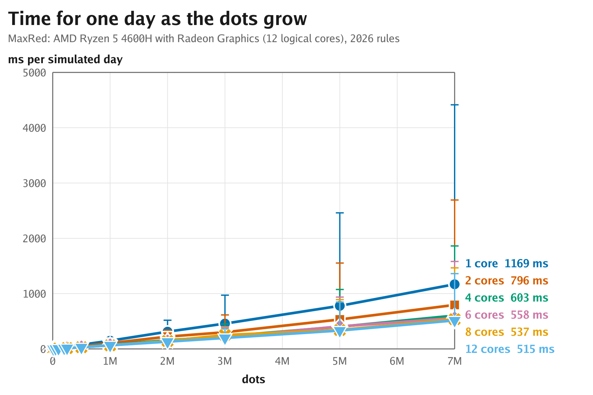
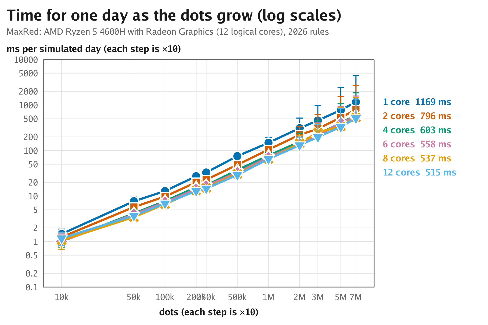
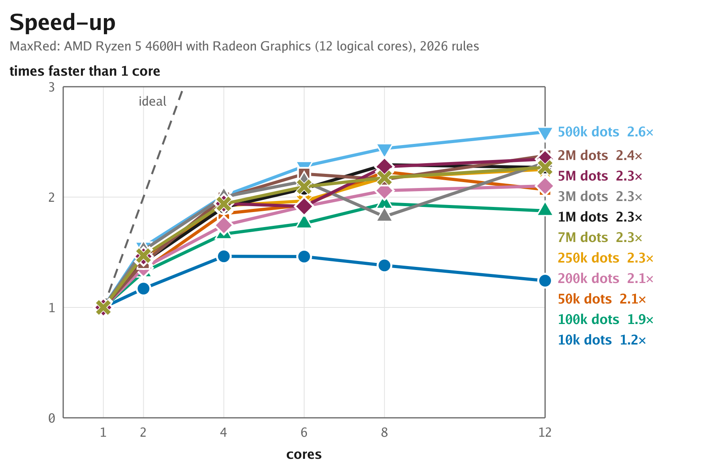
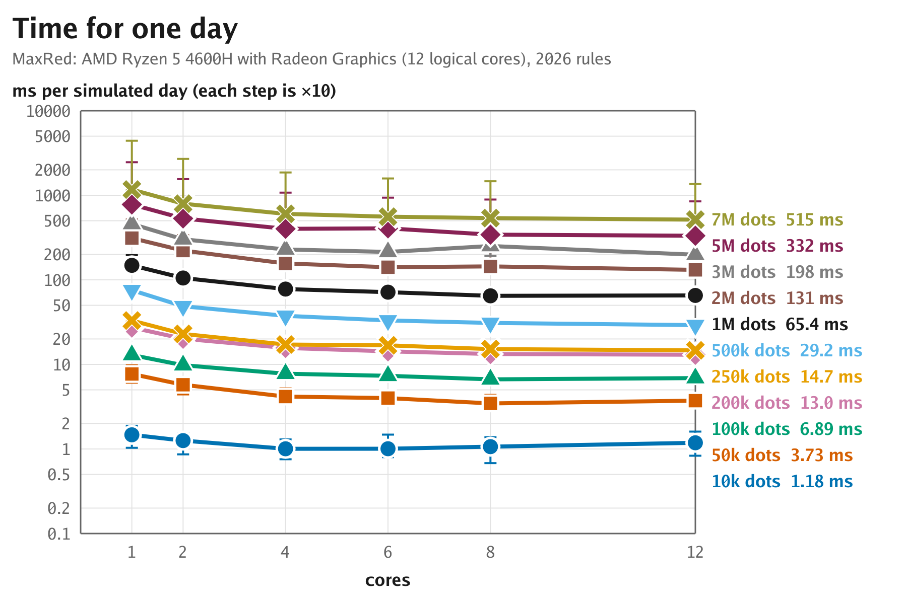
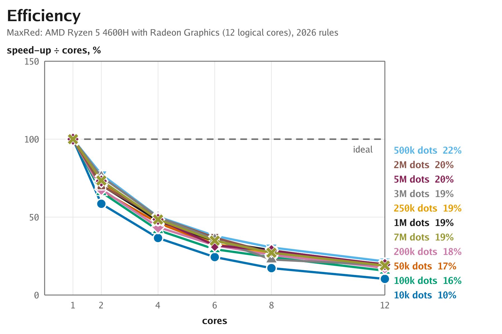
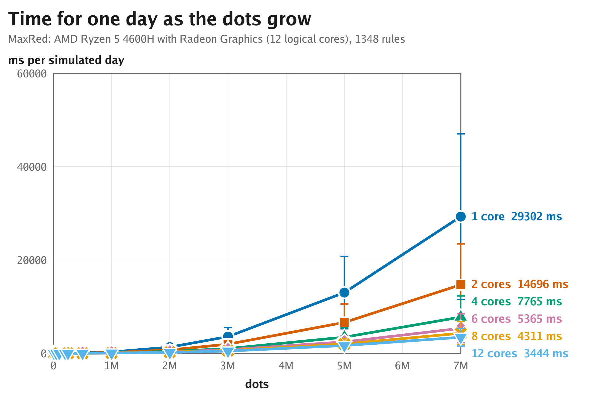
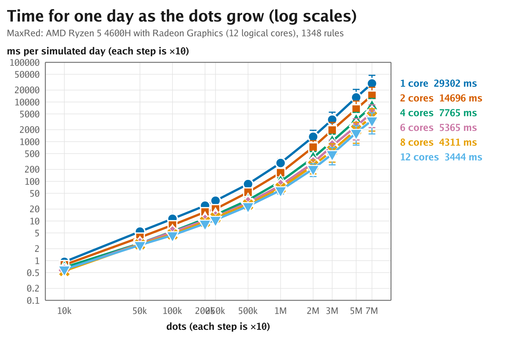
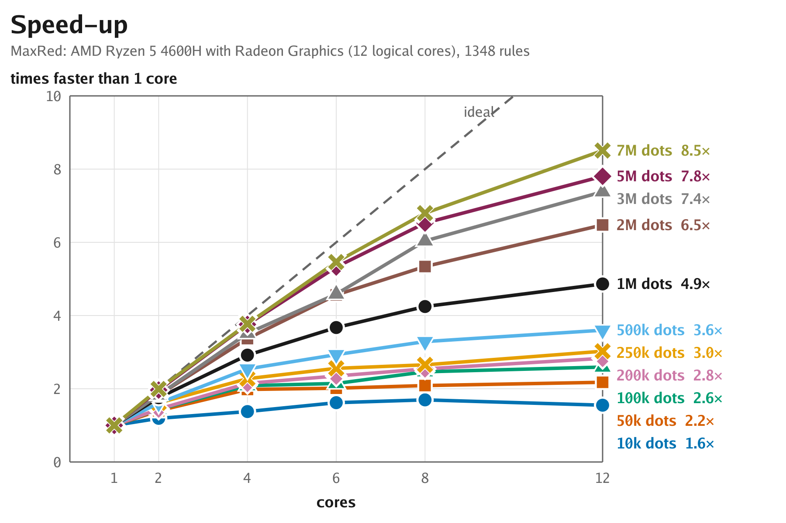
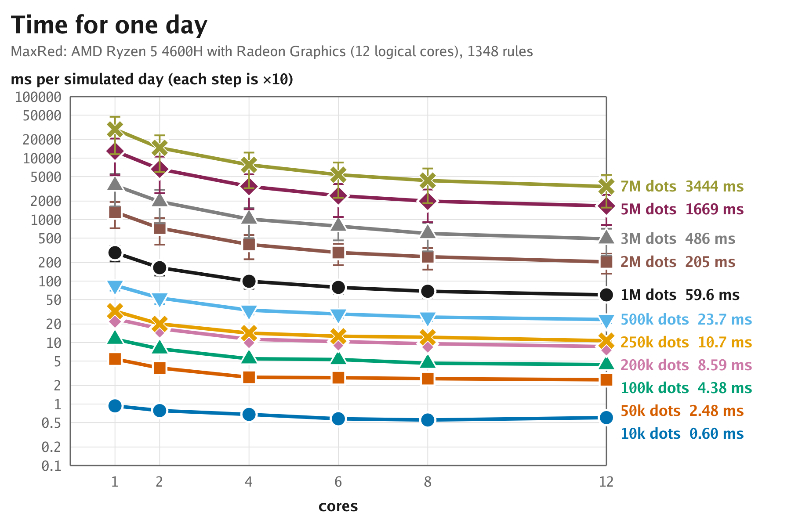
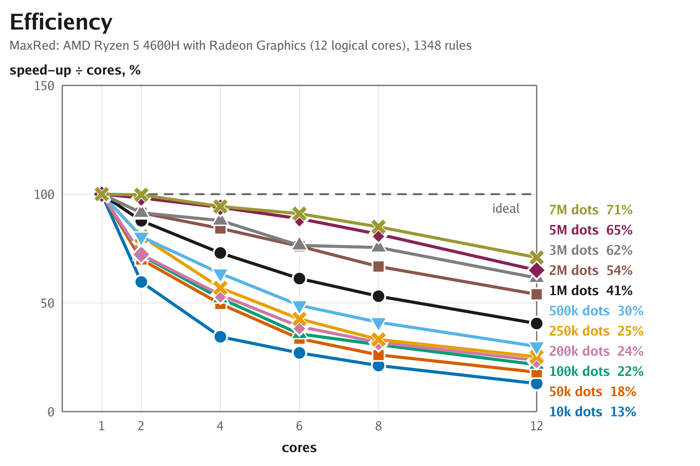

# Benchmark results

Made by `go run ./src -report bench` from `results.csv`. Don't edit it by hand.

# 2026 rules

## MaxRed: AMD Ryzen 5 4600H with Radeon Graphics (12 logical cores), 2026 rules

**10,000 dots** — ✓ same deaths on every core count

| Cores | Median ms/day | Fastest – slowest | Runs | Speed-up | Efficiency |
|---|---|---|---|---|---|
| 1 | 1.47 | 1.03 – 1.88 | 6 | 1.00× | 100% |
| 2 | 1.26 | 0.86 – 1.53 | 6 | 1.17× | 59% |
| 4 | 1.00 | 0.76 – 1.30 | 6 | 1.46× | 37% |
| 6 | 1.01 | 0.80 – 1.48 | 6 | 1.46× | 24% |
| 8 | 1.06 | 0.68 – 1.38 | 6 | 1.38× | 17% |
| 12 | 1.18 | 0.83 – 1.60 | 6 | 1.24× | 10% |

**50,000 dots** — ✓ same deaths on every core count

| Cores | Median ms/day | Fastest – slowest | Runs | Speed-up | Efficiency |
|---|---|---|---|---|---|
| 1 | 7.71 | 6.08 – 9.74 | 6 | 1.00× | 100% |
| 2 | 5.75 | 4.42 – 6.87 | 6 | 1.34× | 67% |
| 4 | 4.17 | 3.39 – 5.22 | 6 | 1.85× | 46% |
| 6 | 4.00 | 3.29 – 4.68 | 6 | 1.93× | 32% |
| 8 | 3.46 | 3.10 – 4.36 | 6 | 2.23× | 28% |
| 12 | 3.73 | 3.16 – 4.32 | 6 | 2.07× | 17% |

**100,000 dots** — ✓ same deaths on every core count

| Cores | Median ms/day | Fastest – slowest | Runs | Speed-up | Efficiency |
|---|---|---|---|---|---|
| 1 | 12.92 | 12.77 – 13.33 | 3 | 1.00× | 100% |
| 2 | 9.79 | 9.52 – 9.93 | 3 | 1.32× | 66% |
| 4 | 7.76 | 7.46 – 7.81 | 3 | 1.67× | 42% |
| 6 | 7.33 | 6.49 – 7.41 | 3 | 1.76× | 29% |
| 8 | 6.66 | 6.53 – 6.89 | 3 | 1.94× | 24% |
| 12 | 6.89 | 6.32 – 7.06 | 3 | 1.88× | 16% |

**200,000 dots** — ✓ same deaths on every core count

| Cores | Median ms/day | Fastest – slowest | Runs | Speed-up | Efficiency |
|---|---|---|---|---|---|
| 1 | 27.33 | 24.84 – 30.38 | 6 | 1.00× | 100% |
| 2 | 20.12 | 18.64 – 20.77 | 6 | 1.36× | 68% |
| 4 | 15.67 | 13.74 – 16.59 | 6 | 1.74× | 44% |
| 6 | 14.27 | 12.66 – 15.23 | 6 | 1.92× | 32% |
| 8 | 13.28 | 11.66 – 13.66 | 6 | 2.06× | 26% |
| 12 | 13.01 | 11.57 – 13.38 | 6 | 2.10× | 18% |

**250,000 dots** — ✓ same deaths on every core count

| Cores | Median ms/day | Fastest – slowest | Runs | Speed-up | Efficiency |
|---|---|---|---|---|---|
| 1 | 33.02 | 32.23 – 35.14 | 3 | 1.00× | 100% |
| 2 | 22.94 | 22.52 – 24.72 | 3 | 1.44× | 72% |
| 4 | 17.18 | 16.58 – 18.29 | 3 | 1.92× | 48% |
| 6 | 16.80 | 16.30 – 17.41 | 3 | 1.96× | 33% |
| 8 | 15.18 | 14.36 – 15.85 | 3 | 2.18× | 27% |
| 12 | 14.67 | 13.69 – 15.14 | 3 | 2.25× | 19% |

**500,000 dots** — ✓ same deaths on every core count

| Cores | Median ms/day | Fastest – slowest | Runs | Speed-up | Efficiency |
|---|---|---|---|---|---|
| 1 | 75.50 | 73.94 – 83.14 | 3 | 1.00× | 100% |
| 2 | 48.74 | 46.75 – 54.65 | 3 | 1.55× | 77% |
| 4 | 37.55 | 36.04 – 38.07 | 3 | 2.01× | 50% |
| 6 | 33.12 | 31.46 – 33.84 | 3 | 2.28× | 38% |
| 8 | 30.94 | 30.83 – 30.96 | 3 | 2.44× | 31% |
| 12 | 29.15 | 27.76 – 34.05 | 3 | 2.59× | 22% |

**1,000,000 dots** — ✓ same deaths on every core count

| Cores | Median ms/day | Fastest – slowest | Runs | Speed-up | Efficiency |
|---|---|---|---|---|---|
| 1 | 148.41 | 142.59 – 196.16 | 6 | 1.00× | 100% |
| 2 | 105.17 | 94.23 – 124.03 | 6 | 1.41× | 71% |
| 4 | 77.82 | 69.00 – 91.65 | 6 | 1.91× | 48% |
| 6 | 71.51 | 62.81 – 78.65 | 6 | 2.08× | 35% |
| 8 | 64.73 | 57.26 – 74.92 | 6 | 2.29× | 29% |
| 12 | 65.43 | 55.83 – 72.99 | 6 | 2.27× | 19% |

**2,000,000 dots** — ✓ same deaths on every core count

| Cores | Median ms/day | Fastest – slowest | Runs | Speed-up | Efficiency |
|---|---|---|---|---|---|
| 1 | 311.64 | 303.13 – 518.85 | 3 | 1.00× | 100% |
| 2 | 221.93 | 198.45 – 338.44 | 3 | 1.40× | 70% |
| 4 | 156.26 | 146.19 – 242.96 | 3 | 1.99× | 50% |
| 6 | 141.02 | 133.78 – 216.42 | 3 | 2.21× | 37% |
| 8 | 144.28 | 134.05 – 213.92 | 3 | 2.16× | 27% |
| 12 | 131.21 | 121.93 – 198.52 | 3 | 2.38× | 20% |

**3,000,000 dots** — ✓ same deaths on every core count

| Cores | Median ms/day | Fastest – slowest | Runs | Speed-up | Efficiency |
|---|---|---|---|---|---|
| 1 | 458.26 | 458.12 – 972.02 | 3 | 1.00× | 100% |
| 2 | 301.67 | 300.09 – 614.75 | 3 | 1.52× | 76% |
| 4 | 228.83 | 226.47 – 450.42 | 3 | 2.00× | 50% |
| 6 | 213.81 | 207.31 – 404.58 | 3 | 2.14× | 36% |
| 8 | 251.30 | 191.19 – 383.27 | 3 | 1.82× | 23% |
| 12 | 198.30 | 189.50 – 373.18 | 3 | 2.31× | 19% |

**5,000,000 dots** — ✓ same deaths on every core count

| Cores | Median ms/day | Fastest – slowest | Runs | Speed-up | Efficiency |
|---|---|---|---|---|---|
| 1 | 779.11 | 777.74 – 2460.58 | 3 | 1.00× | 100% |
| 2 | 532.62 | 510.38 – 1552.81 | 3 | 1.46× | 73% |
| 4 | 401.33 | 390.28 – 1074.82 | 3 | 1.94× | 49% |
| 6 | 406.66 | 351.41 – 937.49 | 3 | 1.92× | 32% |
| 8 | 342.48 | 333.71 – 890.74 | 3 | 2.27× | 28% |
| 12 | 332.38 | 328.84 – 847.37 | 3 | 2.34× | 20% |

**7,000,000 dots** — ✓ same deaths on every core count

| Cores | Median ms/day | Fastest – slowest | Runs | Speed-up | Efficiency |
|---|---|---|---|---|---|
| 1 | 1169.03 | 1144.36 – 4414.38 | 3 | 1.00× | 100% |
| 2 | 795.50 | 773.23 – 2692.79 | 3 | 1.47× | 73% |
| 4 | 603.07 | 575.83 – 1861.94 | 3 | 1.94× | 48% |
| 6 | 558.29 | 529.18 – 1581.51 | 3 | 2.09× | 35% |
| 8 | 537.48 | 494.24 – 1465.72 | 3 | 2.18× | 27% |
| 12 | 515.34 | 475.95 – 1361.27 | 3 | 2.27× | 19% |

# 1348 rules

## MaxRed: AMD Ryzen 5 4600H with Radeon Graphics (12 logical cores), 1348 rules

**10,000 dots** — ✓ same deaths on every core count

| Cores | Median ms/day | Fastest – slowest | Runs | Speed-up | Efficiency |
|---|---|---|---|---|---|
| 1 | 0.93 | 0.92 – 0.95 | 2 | 1.00× | 100% |
| 2 | 0.78 | 0.71 – 0.85 | 2 | 1.19× | 60% |
| 4 | 0.68 | 0.55 – 0.80 | 2 | 1.38× | 34% |
| 6 | 0.58 | 0.50 – 0.65 | 2 | 1.62× | 27% |
| 8 | 0.55 | 0.50 – 0.60 | 2 | 1.70× | 21% |
| 12 | 0.60 | 0.60 – 0.60 | 2 | 1.55× | 13% |

**50,000 dots** — ✓ same deaths on every core count

| Cores | Median ms/day | Fastest – slowest | Runs | Speed-up | Efficiency |
|---|---|---|---|---|---|
| 1 | 5.40 | 5.33 – 5.47 | 2 | 1.00× | 100% |
| 2 | 3.86 | 3.61 – 4.11 | 2 | 1.40× | 70% |
| 4 | 2.73 | 2.70 – 2.75 | 2 | 1.98× | 50% |
| 6 | 2.68 | 2.53 – 2.83 | 2 | 2.01× | 34% |
| 8 | 2.59 | 2.51 – 2.66 | 2 | 2.09× | 26% |
| 12 | 2.48 | 2.40 – 2.56 | 2 | 2.18× | 18% |

**100,000 dots** — ✓ same deaths on every core count

| Cores | Median ms/day | Fastest – slowest | Runs | Speed-up | Efficiency |
|---|---|---|---|---|---|
| 1 | 11.36 | 10.65 – 12.06 | 2 | 1.00× | 100% |
| 2 | 7.90 | 7.57 – 8.24 | 2 | 1.44× | 72% |
| 4 | 5.45 | 5.27 – 5.62 | 2 | 2.08× | 52% |
| 6 | 5.30 | 5.09 – 5.50 | 2 | 2.14× | 36% |
| 8 | 4.61 | 4.52 – 4.70 | 2 | 2.46× | 31% |
| 12 | 4.38 | 4.28 – 4.48 | 2 | 2.59× | 22% |

**200,000 dots** — ✓ same deaths on every core count

| Cores | Median ms/day | Fastest – slowest | Runs | Speed-up | Efficiency |
|---|---|---|---|---|---|
| 1 | 24.33 | 22.86 – 25.81 | 2 | 1.00× | 100% |
| 2 | 16.83 | 15.74 – 17.91 | 2 | 1.45× | 72% |
| 4 | 11.33 | 10.56 – 12.10 | 2 | 2.15× | 54% |
| 6 | 10.36 | 9.72 – 11.01 | 2 | 2.35× | 39% |
| 8 | 9.57 | 9.36 – 9.78 | 2 | 2.54× | 32% |
| 12 | 8.59 | 8.12 – 9.06 | 2 | 2.83× | 24% |

**250,000 dots** — ✓ same deaths on every core count

| Cores | Median ms/day | Fastest – slowest | Runs | Speed-up | Efficiency |
|---|---|---|---|---|---|
| 1 | 32.39 | 31.42 – 33.37 | 2 | 1.00× | 100% |
| 2 | 20.08 | 18.87 – 21.29 | 2 | 1.61× | 81% |
| 4 | 14.24 | 13.28 – 15.20 | 2 | 2.28× | 57% |
| 6 | 12.66 | 12.07 – 13.26 | 2 | 2.56× | 43% |
| 8 | 12.21 | 11.62 – 12.79 | 2 | 2.65× | 33% |
| 12 | 10.71 | 10.27 – 11.15 | 2 | 3.03× | 25% |

**500,000 dots** — ✓ same deaths on every core count

| Cores | Median ms/day | Fastest – slowest | Runs | Speed-up | Efficiency |
|---|---|---|---|---|---|
| 1 | 85.32 | 69.96 – 100.69 | 2 | 1.00× | 100% |
| 2 | 53.05 | 42.22 – 63.88 | 2 | 1.61× | 80% |
| 4 | 33.57 | 28.55 – 38.58 | 2 | 2.54× | 64% |
| 6 | 29.10 | 25.33 – 32.87 | 2 | 2.93× | 49% |
| 8 | 25.95 | 22.46 – 29.43 | 2 | 3.29× | 41% |
| 12 | 23.70 | 20.77 – 26.64 | 2 | 3.60× | 30% |

**1,000,000 dots** — ✓ same deaths on every core count

| Cores | Median ms/day | Fastest – slowest | Runs | Speed-up | Efficiency |
|---|---|---|---|---|---|
| 1 | 289.80 | 208.65 – 370.96 | 2 | 1.00× | 100% |
| 2 | 165.09 | 123.03 – 207.15 | 2 | 1.76× | 88% |
| 4 | 99.29 | 75.06 – 123.53 | 2 | 2.92× | 73% |
| 6 | 78.92 | 61.10 – 96.73 | 2 | 3.67× | 61% |
| 8 | 68.25 | 53.72 – 82.79 | 2 | 4.25× | 53% |
| 12 | 59.60 | 47.85 – 71.34 | 2 | 4.86× | 41% |

**2,000,000 dots** — ✓ same deaths on every core count

| Cores | Median ms/day | Fastest – slowest | Runs | Speed-up | Efficiency |
|---|---|---|---|---|---|
| 1 | 1327.62 | 721.51 – 1933.72 | 2 | 1.00× | 100% |
| 2 | 725.97 | 391.68 – 1060.27 | 2 | 1.83× | 91% |
| 4 | 393.96 | 226.24 – 561.67 | 2 | 3.37× | 84% |
| 6 | 290.91 | 181.28 – 400.53 | 2 | 4.56× | 76% |
| 8 | 248.66 | 153.72 – 343.60 | 2 | 5.34× | 67% |
| 12 | 205.07 | 132.04 – 278.10 | 2 | 6.47× | 54% |

**3,000,000 dots** — ✓ same deaths on every core count

| Cores | Median ms/day | Fastest – slowest | Runs | Speed-up | Efficiency |
|---|---|---|---|---|---|
| 1 | 3584.30 | 1637.49 – 5531.11 | 2 | 1.00× | 100% |
| 2 | 1960.01 | 869.63 – 3050.40 | 2 | 1.83× | 91% |
| 4 | 1019.80 | 498.26 – 1541.33 | 2 | 3.51× | 88% |
| 6 | 781.58 | 459.44 – 1103.71 | 2 | 4.59× | 76% |
| 8 | 593.59 | 304.34 – 882.83 | 2 | 6.04× | 75% |
| 12 | 485.66 | 260.50 – 710.82 | 2 | 7.38× | 62% |

**5,000,000 dots** — ✓ same deaths on every core count

| Cores | Median ms/day | Fastest – slowest | Runs | Speed-up | Efficiency |
|---|---|---|---|---|---|
| 1 | 13022.45 | 5252.76 – 20792.13 | 2 | 1.00× | 100% |
| 2 | 6626.40 | 2685.52 – 10567.28 | 2 | 1.97× | 98% |
| 4 | 3465.40 | 1472.67 – 5458.12 | 2 | 3.76× | 94% |
| 6 | 2445.47 | 1102.95 – 3787.99 | 2 | 5.33× | 89% |
| 8 | 1995.24 | 908.95 – 3081.52 | 2 | 6.53× | 82% |
| 12 | 1668.86 | 819.60 – 2518.13 | 2 | 7.80× | 65% |

**7,000,000 dots** — ✓ same deaths on every core count

| Cores | Median ms/day | Fastest – slowest | Runs | Speed-up | Efficiency |
|---|---|---|---|---|---|
| 1 | 29301.84 | 11574.40 – 47029.29 | 2 | 1.00× | 100% |
| 2 | 14695.71 | 5939.60 – 23451.81 | 2 | 1.99× | 100% |
| 4 | 7765.21 | 3232.36 – 12298.05 | 2 | 3.77× | 94% |
| 6 | 5365.04 | 2260.42 – 8469.66 | 2 | 5.46× | 91% |
| 8 | 4311.15 | 1846.17 – 6776.13 | 2 | 6.80× | 85% |
| 12 | 3444.45 | 1565.65 – 5323.24 | 2 | 8.51× | 71% |

